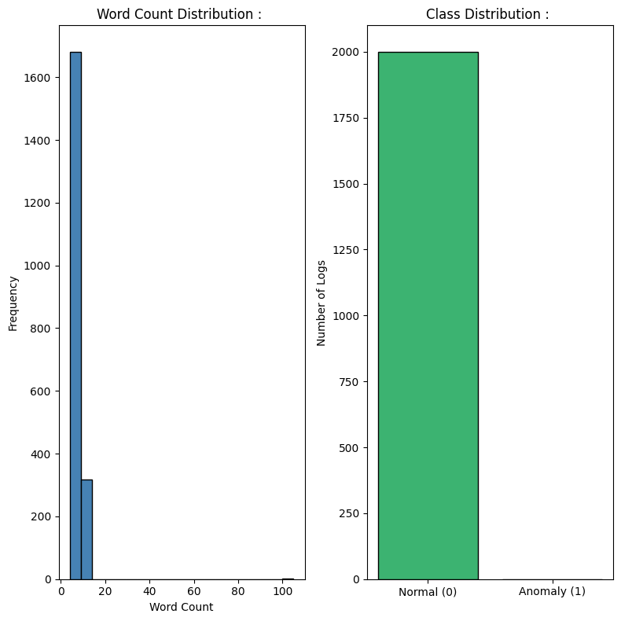
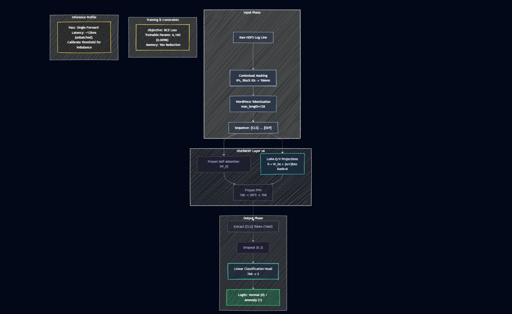

# Distributed System Anomaly Detection via LoRA Fine-Tuned DistilBERT : 


---

## Problem : 

Classify distributed system log lines as Normal or Anomaly in real time, using a pre-trained language model fine-tuned with minimal trainable parameters.

**Dataset :** HDFS_v1 (Hadoop Distributed File System) log dataset. Structured event traces from a distributed cluster, labeled as normal operation or fault events.

**Task :** Binary sequence classification. A single log event is the input; a label of 0 (Normal) or 1 (Anomaly) is the output.

**Significance of Language Model for Logs :** Traditional log monitoring uses regex rules and keyword matching. These approaches break the moment log format changes, a new error code appears, or a novel failure mode occurs. A language model that has been *pre-trained on billions of text tokens* has learned semantic relationships between words; it understands that "block not found on DataNode" is semantically related to failure states even if that exact string was never in a rule.

DistilBERT is fine-tuned on labeled logs, learns the **contextual semantics of distributed system** behavior rather than memorizing specific strings.

---

## Pipeline : 

1. Load the HDFS_v1 dataset (`Event_traces.csv` + `anomaly_label.csv`) and merge on `BlockId` via `dataset_builder.py`
2. Convert labels (`Normal -> 0`, `Anomaly -> 1`) and perform a stratified 80 / 10 / 10 split into `train.csv`, `val.csv`, `test.csv`
3. Strip ephemeral entropy (IP addresses, block IDs, timestamps) from the `Features` column via contextual masking
4. EDA: word count distribution, class distribution
5. Tokenize the `Features` column using WordPiece (DistilBERT tokenizer, max length 128)
6. Load frozen DistilBERT backbone, inject PEFT LoRA adapters into the `q_lin` and `v_lin` projection layers
7. Train only the LoRA adapters and classification head
8. Evaluate: Precision, Recall, F1, Accuracy
9. Serve predictions through a FastAPI backend, with a Streamlit front end for single and batch inference, containerized via Docker

---

## Dataset : 

The project uses the publicly available **HDFS_v1** dataset, stored under `data/raw/HDFS_v1/`.

Two files matter :

**`Event_traces.csv`** contains :
* BlockId
* Event sequence
* Time intervals
* Latency
* Success / Failure metadata

**`anomaly_label.csv`** contains :
BlockId mapped to a Normal / Anomaly label.

`dataset_builder.py` merges both files on `BlockId`, so every event sequence is paired with its ground-truth label before any preprocessing happens.

---

## EDA : 

### Word Count and Class Distribution : 



Log events are very short; word counts cluster between 5 and 15 words. This is characteristic of structured machine logs: they follow templated formats with variable fields (block IDs, IP addresses, operation names). The tight length distribution means padding overhead is minimal and `max_length = 128` tokens is more than sufficient for all logs.

The class distribution shows heavy skew toward Normal logs. The HDFS dataset has extreme class imbalance; anomalies are rare events by definition. This is the operational reality of production monitoring : the overwhelming majority of logs are normal. Evaluation must focus on Recall and F1 for the anomaly class, not overall accuracy.

---

## Data Preprocessing : 

The dataset builder pipeline runs as follows :

**Step 1 :** Read `Event_traces.csv`

**Step 2 :** Read `anomaly_label.csv`

**Step 3 :** Merge both on `BlockId`

**Step 4 :** Convert labels, `Normal -> 0`, `Anomaly -> 1`

**Step 5 :** Keep only the relevant columns : `BlockId`, `Features`, `TimeInterval`, `Latency`, `Label`, `Type`

Only the textual `Features` column is eventually tokenized for DistilBERT; the remaining columns (`TimeInterval`, `Latency`, `Type`) are preserved in the processed CSVs for future feature engineering (for example a hybrid tabular + text model), even though the current classifier does not consume them.

### Contextual Masking : 

Raw log events inside the `Features` column contain ephemeral identifiers; block IDs like `blk_-1608999687919862906`, IP addresses like `10.250.19.102:50010`, and timestamps. These values are unique per log event; they carry no semantic information about whether the event is normal or anomalous.

If the model sees `blk_-1608999687919862906` in training, it may learn to associate that specific block ID with normality, then fail on a normal log with a different block ID. Contextual masking replaces these tokens with generic placeholders (`<BLOCK>`, `<IP>`, `<NUM>`) before tokenization. This forces the attention mechanism to learn the structural pattern of the log rather than memorizing specific values.

This is the log preprocessing principle: strip the noise, preserve the signal.

### WordPiece Tokenization : 

DistilBERT uses WordPiece tokenization, the same subword algorithm used in BERT. It splits words into the largest subword units that exist in the pre-trained vocabulary.

Why this matters for logs: log lines contain programmatic tokens that would never appear in natural language training data. `NullPointerException`, `DataNodeFailed`, `BlkReplication` are not in any dictionary. A word-level tokenizer would map them all to `<UNK>`, losing all information. WordPiece splits them into recognizable sub-units:

```
NullPointerException -> Null + Pointer + Exception
DataNodeFailed -> Data + Node + Failed
```

The component tokens `Null`, `Pointer`, `Exception`, `Failed` all carry semantic meaning that DistilBERT has learned from pre-training. WordPiece recovers this meaning from compound programmatic strings that look like gibberish to word-level tokenizers.

### CLS Token Pooling : 

DistilBERT produces a 768-dimensional vector for every token in the input. For classification, a single fixed-size representation of the entire log event is needed. The `[CLS]` (classification) token is a special token prepended to every input; by design and training, its output embedding is a summary of the entire sequence. The 768-dimensional `[CLS]` vector is extracted and passed to the classification head.

### Stratified Split : 

`dataset_builder.py` performs an 80 / 10 / 10 stratified split into train, validation, and test sets. Stratification preserves the Normal / Anomaly ratio in every split; given how rare anomalies are in HDFS data, a naive random split risks producing a validation or test set with zero anomaly examples, which would make evaluation meaningless. The three resulting files, `train.csv`, `val.csv`, `test.csv`, are written to `data/processed/`.

---

## Dataset Builder : 

`dataset_builder.py` is the single entry point for turning the raw HDFS_v1 files into model-ready data. Given the two raw CSVs, it automatically :

* Merges `Event_traces.csv` and `anomaly_label.csv` on `BlockId`
* Cleans and selects the relevant columns
* Converts string labels to integer labels
* Performs the stratified 80 / 10 / 10 split
* Saves `train.csv`, `val.csv`, `test.csv` to `data/processed/`

No manual preprocessing is required; running the builder once produces every file the training pipeline consumes.

---

## Model : 

The backbone is **DistilBERT Base**, roughly 67M parameters. Rather than fine-tuning it directly, the project uses **PEFT LoRA** from HuggingFace's `peft` library: PEFT injects small trainable low-rank adapter matrices into the attention projection layers, while every original DistilBERT weight stays frozen.

Of the 67,694,596 total parameters, only **739,586** are trainable, about **1.0925%** of the model. This is why PEFT is preferable to a manual LoRA implementation: the adapter injection, freezing of the base model, and merging logic are handled by a maintained library instead of hand-rolled matrix algebra, which reduces the surface area for bugs and keeps the codebase aligned with upstream HuggingFace updates.

---

## LoRA Configuration : 

LoRA adapters are attached using HuggingFace PEFT's `LoraConfig` and `get_peft_model()`.

Target modules :
* `q_lin`
* `v_lin`

Hyperparameters :
* Rank = 8
* Alpha = 16
* Dropout = 0.1

`q_lin` and `v_lin` are the query and value projections inside each attention block; these are the layers most responsible for how the model attends across a log event's tokens, which makes them the highest-leverage place to inject a small adaptation. Restricting adapters to these two projections (instead of every linear layer) keeps the trainable footprint small while still letting the model reweight what it attends to for the anomaly detection task.

This configuration brings the usual PEFT benefits :
* Memory efficiency, only the adapter weights and their Adam optimizer states need gradient memory
* Reduced GPU requirements, the frozen backbone runs forward-pass-only
* Faster fine-tuning, far fewer parameters to update per step

---

## PEFT and LoRA: Efficient Adaptation : 

*PEFT (Parameter-Efficient Fine-Tuning)* is a family of techniques for adapting large pre-trained models to new tasks without updating all parameters. The core insight: most of the task-specific knowledge needed for adaptation lives in a **low-dimensional subspace** of the full parameter space. You do not need to update 67 million parameters to teach the model what an HDFS anomaly looks like.

LoRA (Low-Rank Adaptation) is the most widely used PEFT method. It adds a small number of trainable parameters as a low-rank factorization of the weight update matrix.

---

## LoRA(Math) : 

### The Intrinsic Dimension Hypothesis : 

A pre-trained model that has learned from billions of tokens has already organized its weight space to represent language efficiently. When you fine-tune it on a small downstream task, the meaningful change in weights lives in a very low-dimensional subspace of the full 768x768 weight space. You do not need 589,824 degrees of freedom to represent "this log pattern means anomaly." You need maybe 8.

This is the intrinsic dimension hypothesis: the effective dimension of the fine-tuning optimization landscape is far smaller than the nominal parameter count. LoRA operationalizes this hypothesis into a concrete parameterization.

### The Weight Update Decomposition : 

A standard linear layer in a Transformer has weight matrix $W_0 \in \mathbb{R}^{d \times d}$, where $d = 768$ for DistilBERT.

Full fine-tuning learns an update $\Delta W \in \mathbb{R}^{768 \times 768}$, adding it to the frozen weights:

$$W = W_0 + \Delta W$$

This requires computing and storing gradients for $768 \times 768 = 589{,}824$ values per layer. LoRA instead constrains $\Delta W$ to be low-rank:

$$\Delta W = BA$$

Where :
- $A \in \mathbb{R}^{r \times d} = \mathbb{R}^{8 \times 768}$ is the compressor matrix
- $B \in \mathbb{R}^{d \times r} = \mathbb{R}^{768 \times 8}$ is the broadcaster matrix
- $r = 8$ is the rank (the intrinsic dimension bottleneck)

Parameter count comparison:

$$\Delta W_{\text{full}}: 768 \times 768 = 589{,}824$$

$$\Delta W_{\text{LoRA}}: 8 \times 768 + 768 \times 8 = 12{,}288$$

A 98% reduction in parameters for this matrix alone.

### Forward Pass : 

The modified forward pass for a LoRA-wrapped linear layer :

$$h = W_0 x + \frac{\alpha}{r} B A x$$

Where :
- $W_0 x$ is the frozen pre-trained computation (no gradient, no update).
- $BAx$ is the low-rank adaptation (gradients flow only here).
- $\alpha / r$ is a scaling factor controlling the magnitude of the adaptation relative to the pre-trained output; $\alpha = 16$ and $r = 8$ in this project, so every adaptation is scaled by a factor of 2.

### A and B as Compressor and Broadcaster : 

The geometric interpretation is clean. $A$ compresses the 768-dimensional input into an 8-dimensional bottleneck :

$$z = Ax \in \mathbb{R}^8$$

$B$ then broadcasts this 8-dimensional signal back to 768 dimensions :

$$\Delta h = Bz = BAx \in \mathbb{R}^{768}$$

The bottleneck forces the adaptation to capture only the most essential signal for the task. $A$ must learn which 8 directions in the 768-dimensional space are task-relevant. $B$ must learn how to broadcast those 8 signals back into the full representation space. The two matrices must cooperate ie. the compressor and broadcaster co-adapt during training. A dropout of 0.1 is applied on the LoRA path during training as a regularizer, since the adapters are small enough that they can otherwise overfit the (relatively few) anomaly examples quickly.

### Initialization : 

$A$ is initialized from a Gaussian distribution (random, small values). $B$ is initialized to zero. At initialization, $BA = 0$, so $\Delta W = 0$. The adapted model starts identical to the frozen pre-trained model. This is deliberate; fine-tuning begins from the pre-trained baseline, not from a random perturbation of it.

### Rank and Its Significance : 

Rank $r = 8$ means the adaptation matrix $\Delta W = BA$ has at most 8 linearly independent rows and columns. It is constrained to a rank-8 subspace of the full $768 \times 768$ matrix space.

The task is binary log classification. The semantic difference between a normal HDFS block reception log and an anomalous block-not-found log lives in a small number of semantic dimensions. Empirically, rank 4-16 works well for most fine-tuning tasks. Lower rank means more regularization and less capacity; higher rank approaches full fine-tuning. Rank 8 is a conservative choice that prevents overfitting on a small labeled dataset while providing enough capacity to represent the anomaly vs. normal distinction.

---

## Trainable Parameters : 

| Component | Parameters | Status |
|-----------|------------|--------|
| DistilBERT backbone | 66,955,010 | Frozen (no gradients) |
| LoRA adapters (`q_lin`, `v_lin` across all layers) + classification head | 739,586 | Trainable |
| **Total** | **67,694,596** | - |

739,586 trainable parameters out of 67,694,596 total, an update ratio of **1.0925%**. The frozen backbone takes forward pass computation but contributes no gradient computation, no optimizer state, and no weight update overhead.

---

## Catastrophic Forgetting Prevention : 

Full fine-tuning modifies all pre-trained weights, overwriting the general linguistic knowledge encoded across all layers. On a small domain-specific dataset, the model forgets how language works in general and learns only the specific patterns in training logs.

LoRA prevents this structurally. The pre-trained weights $W_0$ are never modified; they are literally frozen via `requires_grad = False`, enforced by PEFT when the adapter is attached. Only the adapter matrices are updated. The pre-trained knowledge is permanently preserved. At inference, the adapted output $W_0 x + \frac{\alpha}{r} BAx$ uses both the pre-trained knowledge and the task-specific adaptation simultaneously. The model retains linguistic competence and gains domain knowledge.

---

## Model Architecture : 

```
Raw Dataset (Event_traces.csv + anomaly_label.csv)
    |
Dataset Builder (merge on BlockId, label conversion, column selection)
    |
Train / Val / Test (stratified 80/10/10 split)
    |
Contextual masking (strip IPs, block IDs, timestamps on Features column)
    |
Tokenizer (WordPiece, max_length=128, [CLS] prepended)
    |
DistilBERT backbone (6 transformer layers, 67M params, FROZEN)
    Each attention layer: q_lin, v_lin projections wrapped with PEFT LoRA
    W0x + (alpha/r) * BAx for each LoRA-wrapped projection
    |
LoRA Adapters (rank=8, alpha=16, dropout=0.1)
    |
[CLS] token output (768d vector, full sequence summary)
    |
Classification Head (Dropout 0.3, Linear 768 -> 2)
    |
Prediction: Normal (0) or Anomaly (1)
```



---

## Training Pipeline : 

```
dataset_builder.py
    |
LogDataset
    |
Tokenizer
    |
DataLoader
    |
DistilBERT
    |
PEFT LoRA
    |
CrossEntropy Loss
    |
AdamW
    |
Linear Warmup Scheduler
    |
Evaluation
    |
Checkpoint Saving
```

Only the LoRA adapter weights and the classification head are trainable at every step; the tokenizer is saved alongside the checkpoint so inference never depends on rebuilding it from scratch.

---

## Training : 

Training uses the **AdamW** optimizer with a **linear warmup scheduler**. Validation runs every epoch on `val.csv`, and the checkpoint with the best **F1-score** on the anomaly class is kept, not simply the checkpoint from the final epoch, since accuracy alone is a poor signal under the dataset's class imbalance.

The best checkpoint is written using `save_pretrained()`, and the tokenizer is saved together with it, so `checkpoints/` is a self-contained, loadable artifact.

---

## Time, Space, and Inference Complexity : 

Let $L$ = DistilBERT layers (6), $d$ = model dimension (768), $r$ = LoRA rank (8), $N$ = sequence length (max 128), $K$ = training samples, $E$ = epochs.

**Training complexity:**

The frozen backbone runs its full $O(L \cdot N^2 \cdot d)$ attention computation in the forward pass (no gradient).

Gradients are computed only for the LoRA matrices :

$$O(E \cdot K \cdot L \cdot N \cdot d \cdot r)$$

The $r$ term replaces $d$ in the gradient computation because the LoRA path compresses through $r=8$ dimensions before expanding. This is the computational saving: $r \ll d$ means the **backward pass is drastically cheaper** than full fine-tuning.

**Space complexity :**

Optimizer state for LoRA parameters only: $O(L \cdot r \cdot d)$, compared to $O(L \cdot d^2)$ for full fine-tuning. For $L=6$, $r=8$, $d=768$: $6 \times 8 \times 768 = 36{,}864$ optimizer values (per matrix pair) vs $6 \times 589{,}824 = 3{,}538{,}944$ for full fine-tuning of a single projection type. Substantially less optimizer memory across the board.

**Inference complexity per log event :**

$$O(L \cdot N^2 \cdot d + L \cdot N \cdot d \cdot r)$$

The frozen BERT forward pass dominates; the LoRA addition is $O(N \cdot d \cdot r)$ per layer, negligible compared to the $O(N^2 \cdot d)$ attention.

---

## Project Structure : 

```
.
├── api/
├── app/
├── config/
├── data/
│   ├── raw/
│   │   └── HDFS_v1/
│   │       ├── Event_traces.csv
│   │       └── anomaly_label.csv
│   └── processed/
│       ├── train.csv
│       ├── val.csv
│       └── test.csv
├── inference/
├── models/
├── training/
├── checkpoints/
├── run.py
├── Dockerfile
├── requirements.txt
├── README.md
└── .gitignore
```

Key scripts :
* `dataset_builder.py`, builds the merged, split, model-ready dataset
* `trainer.py`, runs the LoRA fine-tuning loop
* `evaluate.py`, computes Precision, Recall, F1, Accuracy on held-out data
* `predictor.py`, loads the checkpoint and serves predictions
* `streamlit_app.py`, the interactive front end
* `main.py`, the FastAPI application entry point
* `schemas.py`, Pydantic request/response models

---

## Implementation Details : 

* Backbone: DistilBERT Base
* Sequence length: 128
* LoRA rank: 8
* LoRA alpha: 16
* LoRA dropout: 0.1
* Target modules: `q_lin`, `v_lin`
* Epochs: 4

Batch size and learning rate are defined in `config.py`, and every value above is expected to match that file; if you change a hyperparameter, update `config.py` first and treat it as the source of truth.

---

## Checkpoint : 

Each checkpoint in `checkpoints/` bundles the PEFT adapter weights and the tokenizer, both written via `save_pretrained()`. Because the adapter is saved separately from the frozen base model, checkpoints are small; loading one at inference time means loading the base DistilBERT once and then attaching whichever adapter is needed.

---

## Inference : 

`predictor.py` loads three pieces at startup: the tokenizer, the PEFT adapter, and the base DistilBERT model, then merges them into a single callable classifier.

**Single prediction :** a raw log event goes in, gets contextually masked and tokenized, and comes back as a label with a confidence score.

**Batch prediction :** a list (or uploaded CSV) of log events is tokenized and run through the model together, which amortizes the fixed overhead per call and is the recommended path for anything beyond a handful of log lines.

Every prediction reports a confidence score (softmax probability of the predicted class) and a measured latency in milliseconds, so slow requests are visible rather than hidden.

---

## FastAPI Deployment : 

`main.py` exposes a small, production-oriented API surface :

* `GET /`, health check
* `POST /predict`, single log event in, label + confidence + latency out
* `POST /batch_predict`, a list of log events in, one prediction per event out

Requests and responses are validated with Pydantic schemas defined in `schemas.py`, and every endpoint returns JSON. This is the layer other services would talk to in production; the Streamlit app below is a client of this API, not a replacement for it.

---

## Streamlit Interface : 

`streamlit_app.py` is a thin interactive client over the FastAPI backend, supporting :

* Single log prediction, paste one log event and get an instant label
* Batch CSV upload, upload a file of log events for bulk scoring
* A prediction table showing label, confidence, and latency per row
* CSV download of the scored results

The Streamlit app never touches the model directly; every prediction goes through the FastAPI `/predict` or `/batch_predict` endpoints, which keeps the model-serving logic in one place.

---

## Docker : 

A `Dockerfile` packages the FastAPI service (and its dependencies) into a container, so the same environment that trained and validated the model runs in production. Containerizing gives reproducible builds, isolates dependencies from the host system, and makes deployment to any container-capable environment (a VM, Kubernetes, a cloud run service) the same process regardless of where it happens.

---

## Requirements : 

* torch
* transformers
* peft
* accelerate
* pandas
* numpy
* scikit-learn
* fastapi
* uvicorn
* streamlit
* requests

---

## Results : 

Training currently in progress on the HDFS_v1 (`Event_traces.csv` + `anomaly_label.csv`) pipeline described above. Results will be updated after complete fine-tuning; the accuracy, precision, recall, and F1 numbers from the previous raw-log-line pipeline no longer apply since both the dataset source and the preprocessing steps have changed, and reporting them here would be misleading.

---

## Failure Case Analysis : 

**Class imbalance in evaluation :** HDFS anomalies are rare relative to Normal events. Precision, Recall, and F1 for the Anomaly class are only meaningful if the evaluation split actually contains anomaly examples, which is exactly why the dataset builder uses a stratified split instead of a random one. Overall accuracy alone is trivially high on an imbalanced set and should not be trusted in isolation.

**Class imbalance at inference time :** In production HDFS deployments, anomaly rates are 0.01-0.1%. A model trained without class weighting or oversampling learns to be very confident about Normal predictions and may have a high effective decision threshold for Anomaly. False negatives (missed anomalies) are far more costly than false positives in production monitoring. Weighted cross-entropy loss or threshold tuning on a calibration set is worth revisiting before deployment.

**Contextual masking information loss :** Stripping block IDs and IP addresses from the `Features` column removes ephemeral noise but also removes structural signals. A repeated block ID appearing in multiple consecutive logs often indicates a retry loop or replication failure; that cross-log pattern is invisible to a single-event classifier. Sequential log analysis (grouping logs by session, block, or time window, which the preserved `TimeInterval` and `Latency` columns would support) recovers this signal but requires a more complex architecture than the current single-event classifier.

**LoRA rank underfitting for complex anomaly types :** Rank 8 works well for the binary distinction between normal log patterns and common failure patterns. Novel zero-day anomalies that involve subtle semantic signals (a sequence of normal-looking operations that collectively indicate compromise) may require higher rank or additional task-specific heads to detect. The intrinsic dimension of more complex anomaly detection may exceed 8.

**Inference latency for real-time monitoring :** Single-request inference carries fixed per-call overhead that batching amortizes away; high-throughput distributed systems generating thousands of log lines per second should always go through `/batch_predict` rather than one `/predict` call per line. DistilBERT is already 40% faster than BERT-base; further optimization requires quantization (INT8 weights reduce memory and increase throughput), ONNX export for optimized inference runtimes, or TensorRT compilation for GPU acceleration.

**Domain shift from pre-training to HDFS logs :** DistilBERT was pre-trained on BookCorpus and English Wikipedia; not distributed system logs. The vocabulary overlap between natural language and HDFS logs is partial. WordPiece handles OOV tokens reasonably but the semantic associations DistilBERT learned for words like "block," "node," and "receive" in natural language contexts differ from their meanings in distributed systems. Extended pre-training on unlabeled system logs before LoRA fine-tuning (domain-adaptive pre-training) would improve representation quality.

---

## Future Work : 

* Quantization
* ONNX export
* TensorRT compilation
* Publishing the adapter to the HuggingFace Hub
* Production monitoring
* Cloud deployment
* GPU inference optimization

---

## Key Takeaways : 

- PEFT LoRA makes large model fine-tuning tractable on small domain-specific datasets by replacing full parameter updates with low-rank factorized updates. 739,586 trainable parameters vs 67,694,596 total; a 1.0925% update ratio.
- The rank $r$ is the *intrinsic dimension bottleneck*. It controls how many linearly independent directions the adaptation is allowed to use. Rank 8 is sufficient for binary log classification; more complex tasks require higher rank.
- $A$ compresses 768 dimensions to 8; $B$ broadcasts 8 dimensions back to 768. They co-adapt during training, with $A$ learning what to extract and $B$ learning how to inject it back into the representation.
- WordPiece tokenization recovers semantic meaning from compound programmatic tokens by splitting them into sub-units that overlap with the pre-training vocabulary. This is essential for log data where identifiers combine natural language words with programmatic suffixes.
- Contextual masking is the log-specific preprocessing step that separates structural learning from value memorization. Without it, the *model overfits* to specific block IDs and IP addresses.
- *Catastrophic forgetting* is prevented structurally; frozen weights cannot be modified. PEFT LoRA does not just mitigate catastrophic forgetting; it makes it mathematically impossible.
- Production deployment of BERT-scale models for log classification requires batched inference, a real serving layer (FastAPI), quantization, and threshold calibration on a balanced evaluation set. Single-sample inference is not production-grade for high-throughput systems on its own.
